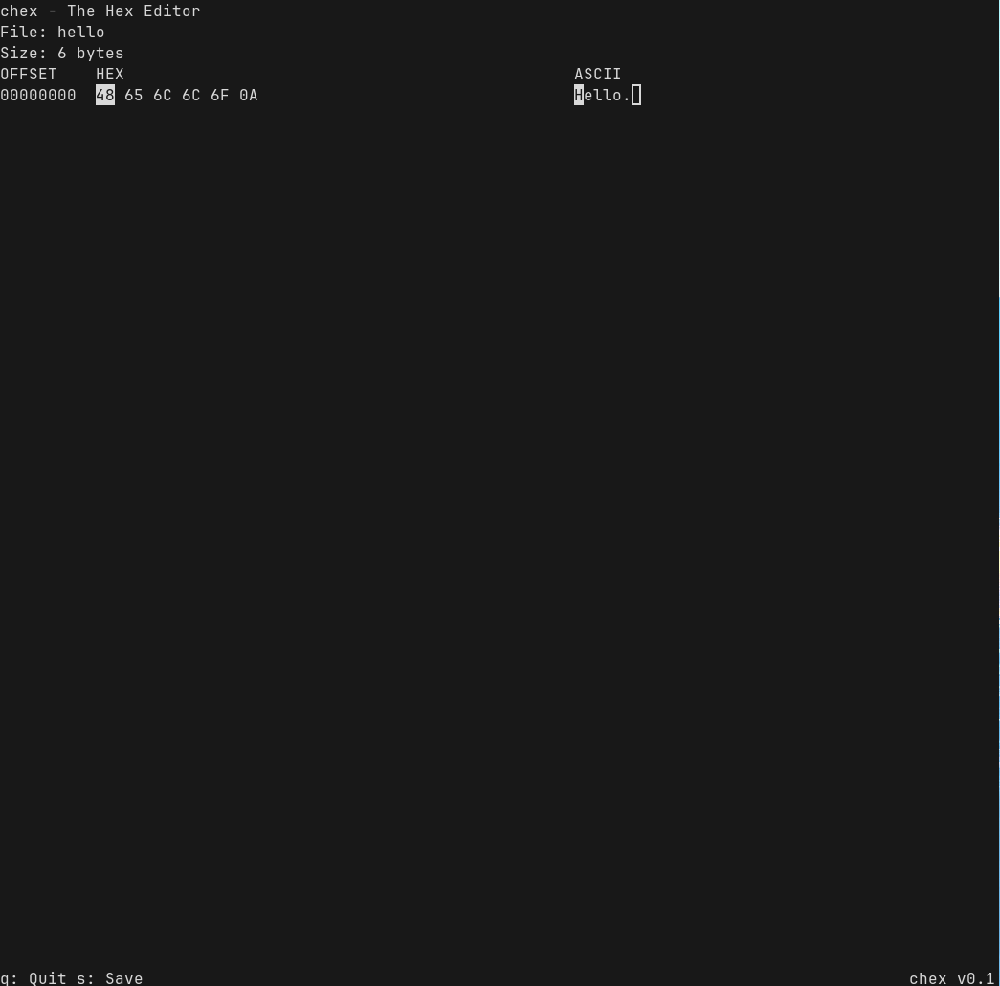

# chex - lightweight hex utility written in C.
## usage
```console
chex -d(dump)/-e(edit) <file>
```

## example of work
- dump mode
```text
OFFSET    HEX                                               ASCII
00000000  48 65 6C 6C 6F 0A                                 Hello.
```
- edit mode

